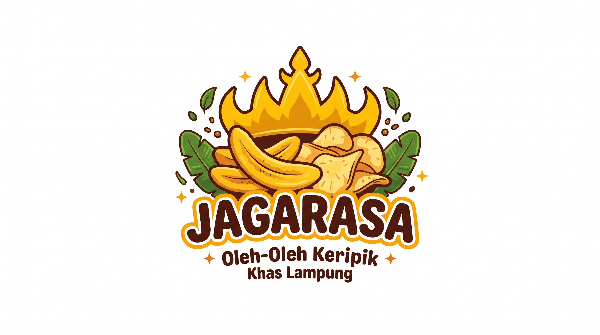

<p align="center">
  
</p>

<h1 align="center">JAGARASA - Website Katalog & Manajemen Produk UMKM</h1>

<p align="center">
  <strong>"Menjaga Keaslian Rasa, Menghadirkan Kehangatan Lampung"</strong><br>
  Platform Website Katalog Publik & Panel CRUD Manajemen Produk Pusat Oleh-Oleh Khas Lampung berbasis Laravel.
</p>

<p align="center">
  
  
  
  
</p>

---

## 📌 Tentang JAGARASA

**JAGARASA** adalah UMKM kuliner yang memproduksi dan memasarkan aneka camilan autentik khas Provinsi Lampung, seperti Keripik Pisang Kepok aneka rasa, Keripik Singkong Balado, Kemplang Panggang Ikan Tenggiri, dan Kopi Robusta dataran tinggi Lampung. Website ini dibangun untuk memenuhi kriteria proyek UTS Pengembangan Aplikasi Web Berbasis Framework Laravel dengan struktur kode yang bersih (*Clean Code MVC*).

---

## ✨ Fitur Utama

### 1. Halaman Publik
- **Hero Section:** Banner sambutan bertema Siger Lampung & kehangatan oleh-oleh khas.
- **Profil UMKM:** Kisah pendirian, komitmen bahan lokal, higienitas kemasan, dan bumbu autentik.
- **Katalog Interaktif:** Filter produk dinamis berdasarkan kategori (*Keripik Pisang*, *Keripik Singkong*, *Kemplang & Olahan Ikan*, *Kopi Lampung*).
- **Halaman Detail Produk (`/produk/{slug}`):** Foto produk, harga berformat Rupiah, berat bersih, status ketersediaan stok, deskripsi cita rasa, rekomendasi produk sejenis, dan tombol pemesanan langsung terhubung ke WhatsApp.

### 2. Panel Admin CRUD (`/admin/produk`)
- **Tabel Manajemen Produk:** Menampilkan daftar foto thumbnail, nama, kategori, harga, dan stok.
- **Tambah Produk Baru (`create`):** Formulir lengkap dengan fitur *Live Preview* gambar sebelum diunggah.
- **Edit Produk (`edit`):** Ubah data produk dan opsional ganti gambar dengan pembersihan file lama otomatis.
- **Hapus Produk (`destroy`):** Menghapus data produk sekaligus membersihkan aset foto terkait dari `storage/app/public/produk`.
- **Validasi Server-Side:** Menggunakan Laravel Form Request (`StoreProductRequest` & `UpdateProductRequest`).

---

## 🛠️ Tech Stack & Arsitektur

- **Framework:** Laravel (PHP 8.2+)
- **Database Relasi (One-to-Many):** Tabel `categories` hasMany `products` (cascade on delete)
- **Eloquent ORM:** Eager loading `Product::with('category')` untuk efisiensi query
- **Frontend & Styling:** Blade Template + Tailwind CSS CDN + Font Awesome 6 + Google Fonts (Plus Jakarta Sans & Inter)
- **Storage Management:** Laravel Public Storage Disk (`storage/app/public/produk`)

---

## 🚀 Panduan Instalasi Lokal

### 1. Clone Repository
```bash
git clone https://github.com/icacruzz/jagarasa.git
cd jagarasa
```

### 2. Install Dependensi PHP
```bash
composer install
```

### 3. Konfigurasi Lingkungan (`.env`)
Salin file template `.env.example` ke `.env`:
```bash
cp .env.example .env
```
Sesuaikan konfigurasi database jika menggunakan MySQL atau gunakan SQLite bawaan.

### 4. Generate App Key & Database
```bash
php artisan key:generate
php artisan migrate --seed
```
*Seeder akan otomatis mengisi 4 kategori oleh-oleh dan 5 produk unggulan awal.*

### 5. Buat Symbolic Link Storage
```bash
php artisan storage:link
```

### 6. Jalankan Server Lokal
```bash
php artisan serve
```
Akses melalui browser:
- **Halaman Publik:** [http://localhost:8000](http://localhost:8000)
- **Panel Admin CRUD:** [http://localhost:8000/admin/produk](http://localhost:8000/admin/produk)

---

## 🗂️ Struktur File Penting

```text
jagarasa/
├── app/
│   ├── Http/
│   │   ├── Controllers/
│   │   │   ├── HomeController.php          # Controller Halaman Publik & Detail
│   │   │   └── Admin/
│   │   │       └── ProductController.php   # Controller CRUD Admin & Storage
│   │   └── Requests/
│   │       ├── StoreProductRequest.php     # Validasi Form Tambah Produk
│   │       └── UpdateProductRequest.php    # Validasi Form Edit Produk
│   └── Models/
│       ├── Category.php                    # Model Kategori
│       └── Product.php                     # Model Produk & Helper Relasi
├── database/
│   ├── migrations/                         # Tabel categories & products
│   └── seeders/
│       ├── CategorySeeder.php              # Seeder 4 Kategori
│       └── ProductSeeder.php               # Seeder 5 Produk Awal
├── public/
│   └── images/
│       └── logo-jagarasa.png               # Aset Logo Resmi
└── resources/
    └── views/
        ├── layouts/                        # Master Layout Publik & Admin
        ├── components/                     # Reusable Product Card
        ├── home/                           # Blade View Beranda & Detail
        └── admin/products/                 # Blade View CRUD Admin
```

---

## 📄 Lisensi
Proyek ini dibuat untuk keperluan akademik dan didistribusikan di bawah lisensi [MIT](LICENSE).
